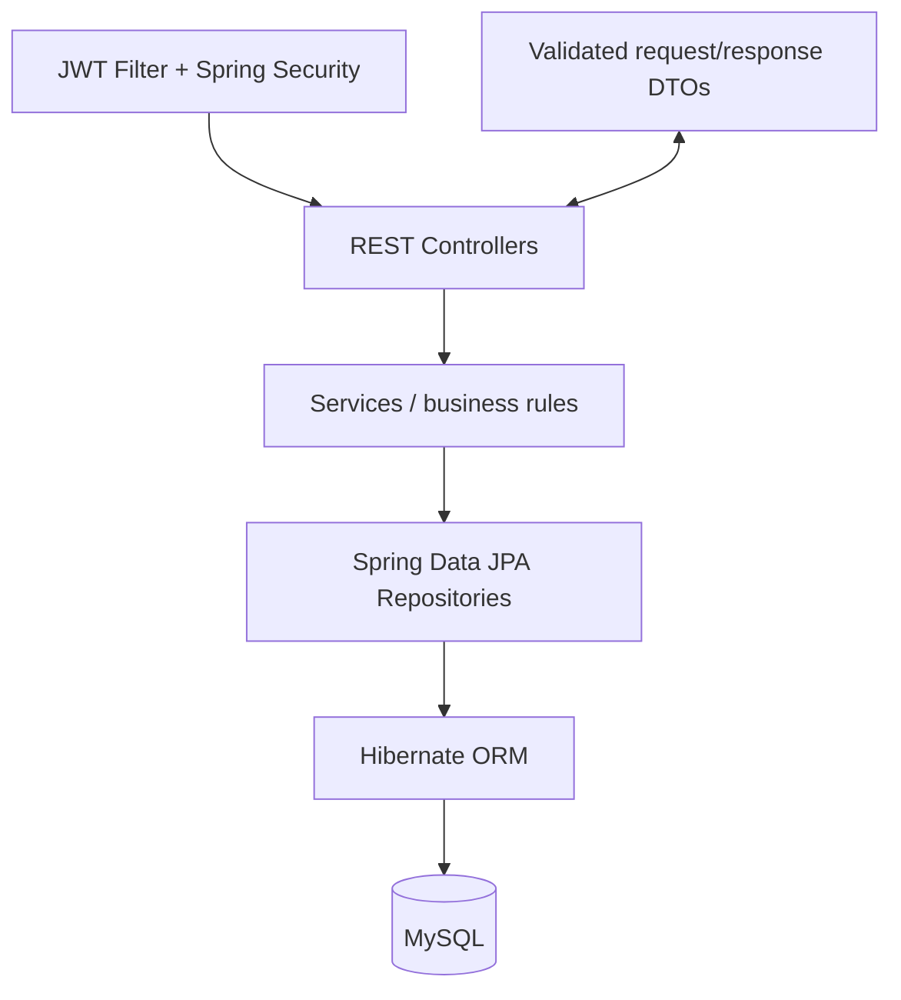

# ExamPro — Online Examination and Assessment System

A backend-only examination system built with Java 21, Spring Boot, Spring Security, JWT, Spring Data JPA, Hibernate, and MySQL 8. No frontend or AI features are included.

## Features
- Student registration/login, BCrypt password hashing, JWT access tokens and student/admin roles.
- Subject CRUD, MCQ question bank, exam creation and question assignment.
- Server-enforced timed attempts, protected answer saving, server-side scoring and result history.
- MySQL persistence, validation, central error responses, Swagger UI and DBMS practical SQL examples.

## Requirements
- JDK 21
- Maven 3.9+
- MySQL 8.x
- IntelliJ IDEA or Google Antigravity

## 1. Create the database and user
Run in MySQL Workbench or the MySQL CLI:
```sql
CREATE DATABASE exampro CHARACTER SET utf8mb4 COLLATE utf8mb4_0900_ai_ci;
CREATE USER 'exampro_user'@'localhost' IDENTIFIED BY 'replace_with_a_strong_password';
GRANT ALL PRIVILEGES ON exampro.* TO 'exampro_user'@'localhost';
FLUSH PRIVILEGES;
```

## 2. Configure environment variables (Windows PowerShell)
Set these in the terminal before starting the app (replace values):
```powershell
$env:DB_URL="jdbc:mysql://localhost:3306/exampro?useSSL=false&allowPublicKeyRetrieval=true&serverTimezone=UTC"
$env:DB_USERNAME="exampro_user"
$env:DB_PASSWORD="replace_with_a_strong_password"
$env:JWT_SECRET="replace-with-a-random-secret-at-least-32-bytes-long"
$env:ADMIN_EMAIL="admin@example.com"
$env:ADMIN_PASSWORD="Use-A-Strong-Admin-Password-123!"
$env:ADMIN_NAME="ExamPro Admin"
```
The admin is provisioned only if `ADMIN_EMAIL` and `ADMIN_PASSWORD` are configured and that email does not already exist. Admin password must be at least 12 characters. There is no public admin registration endpoint. Never commit real secrets.

For quick local experimentation only, `application.properties` has a local fallback DB username of `root` and blank password. Prefer environment variables.

## 3. Build and run
From the project directory:
```powershell
mvn clean test
mvn spring-boot:run
```
Or build a jar:
```powershell
mvn clean package
java -jar target/exampro-1.0.0.jar
```
The app starts at `http://localhost:8080`. First startup creates tables through Hibernate `ddl-auto=update`. This setting is for local development; use reviewed Flyway migrations and `validate` for production.

## 4. First API workflow
1. Open `http://localhost:8080/swagger-ui.html`.
2. Register a student at `POST /api/auth/register` and copy the returned JWT.
3. Log in as the configured admin at `POST /api/auth/login`; copy the JWT.
4. Use Swagger's Authorize control or set `Authorization: Bearer <token>`.
5. As admin, create a subject, create questions (exactly one correct option each), create an exam, then assign question IDs.
6. As student, start an attempt, save answers, and submit it. Read results via `GET /api/results/my`.

Example registration:
```json
{"fullName":"Asha Student","email":"asha@example.com","password":"StudentPass123"}
```
Example question:
```json
{"text":"Which keyword inherits a class in Java?","subjectId":1,"difficulty":"EASY","marks":2,"options":[{"text":"extends","correct":true},{"text":"implements","correct":false}]}
```

## Architecture

See `docs/er-diagram.md` and `docs/api-guide.md`. SQL practice queries and a results view are in `database/dbms-practical-queries.sql`.

## Tests
Run `mvn test`. The starter includes a Spring context test. Add a dedicated integration-test database before running integration tests against real MySQL. Do not claim tests pass until executed in your environment.

## Known scope / next improvements
- No frontend by design.
- Add Flyway migration scripts before production deployment.
- Add pagination, rate limiting, refresh-token/logout strategy, audit trail, and integration tests with Testcontainers.
- Tighten historical record deletion rules before production use; avoid deleting questions/exams linked to attempts.
- Add an explicit admin bootstrap deployment process and rotate JWT secrets regularly.

## Troubleshooting
- **Access denied for MySQL:** check DB username/password and grants.
- **Communications link failure:** start MySQL and verify port 3306/DB_URL.
- **JWT secret error:** set `JWT_SECRET` to at least 32 bytes.
- **401:** sign in again and send `Authorization: Bearer <token>`.
- **403:** endpoint requires the ADMIN role; student accounts cannot promote themselves.
- **Port 8080 busy:** set `server.port=8081` in application.properties.
- **Maven not found:** install Maven 3.9+ and add its `bin` directory to PATH, then reopen the terminal.

## Resume description
Developed ExamPro, a RESTful online examination backend using Java 21, Spring Boot, Spring Security, JWT, JPA/Hibernate and MySQL, with role-based access, MCQ management, timed attempts, server-side scoring, and Swagger API documentation. Verify and describe only features you have personally run and tested.
