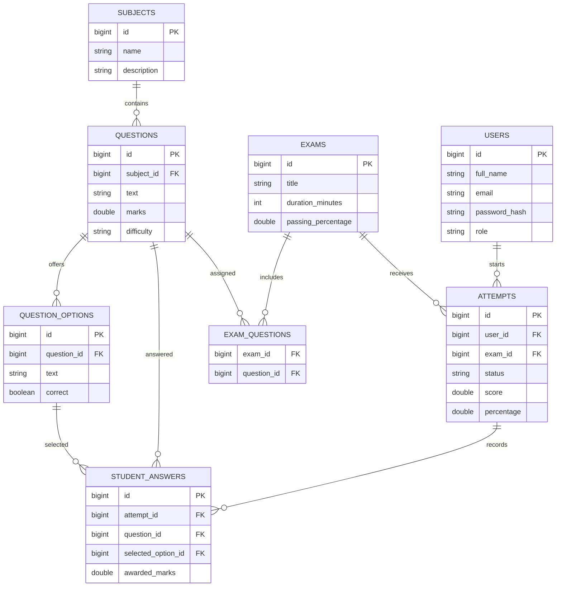

# ExamPro ER Diagram

Relationships are normalized to separate subjects, questions, options, exams, attempts, and answers. Historical attempts should be retained; avoid deleting exams/questions after they have attempts.
